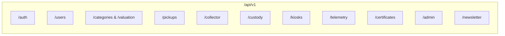

# EcoCircuit — API Specification & Integration Plan

**Platform:** EcoCircuit — Smart E-Waste Management Platform  
**API Version:** `v1`  
**Base Path:** `/api/v1`  
**Architecture:** RESTful JSON API + Server-Sent Events (SSE) / WebSockets for Live Telemetry  
**Security:** Bearer JWT / HttpOnly SameSite Cookie + RBAC Guard Middleware  

---

## 1. Global API Standards & Conventions

### 1.1 Request Headers
All requests must communicate standard headers:
```http
Content-Type: application/json
Accept: application/json
Authorization: Bearer <jwt_access_token> # (Or verified via HttpOnly cookie)
X-Client-Version: 1.0.0
```

### 1.2 Standard Success Envelope
```json
{
  "success": true,
  "data": { ... },
  "meta": {
    "timestamp": "2026-10-22T23:45:00Z",
    "requestId": "req_88f9b1c2"
  }
}
```

### 1.3 Standard Error Envelope
```json
{
  "success": false,
  "error": {
    "code": "RESOURCE_NOT_FOUND",
    "message": "Pickup request with ID EC-9041 not found.",
    "details": [
      {
        "field": "trackingNumber",
        "issue": "Invalid format"
      }
    ]
  },
  "meta": {
    "timestamp": "2026-10-22T23:45:00Z"
  }
}
```

### 1.4 HTTP Status Codes
- `200 OK`: Successful retrieval or update.
- `201 Created`: Resource created successfully.
- `400 Bad Request`: Validation failure (Zod validation errors).
- `401 Unauthorized`: Missing or expired authentication token.
- `403 Forbidden`: Authenticated user lacks required role permissions.
- `404 Not Found`: Target entity does not exist.
- `409 Conflict`: Duplicate entry (e.g. email or license already registered).
- `429 Too Many Requests`: Exceeded rate limit thresholds.
- `500 Internal Server Error`: Unhandled application exception.

---

## 2. API Endpoint Catalog



---

## 3. Detailed Endpoint Specifications

### 3.1 Authentication & Identity Subsystem

#### `POST /api/v1/auth/register`
Creates a new account (default role: `CITIZEN` or `ENTERPRISE`).
- **Access:** Public
- **Request Body:**
```json
{
  "email": "sarah.chen@example.com",
  "password": "StrongPassword123!",
  "firstName": "Sarah",
  "lastName": "Chen",
  "phoneNumber": "+1-415-555-0192",
  "role": "CITIZEN"
}
```
- **Response (201 Created):**
```json
{
  "success": true,
  "data": {
    "user": {
      "id": "c7a8b9d0-1234-5678-90ab-cdef12345678",
      "email": "sarah.chen@example.com",
      "firstName": "Sarah",
      "lastName": "Chen",
      "role": "CITIZEN"
    },
    "token": "eyJhbGciOiJIUzI1NiIsInR5cCI6IkpXVCJ9..."
  }
}
```

#### `POST /api/v1/auth/login`
Authenticates user, verifies password against Argon2id hash, and sets session cookie.
- **Access:** Public
- **Request Body:**
```json
{
  "email": "sarah.chen@example.com",
  "password": "StrongPassword123!"
}
```

#### `GET /api/v1/auth/me`
Retrieves authenticated user profile and active permissions.
- **Access:** Authenticated (`CITIZEN`, `COLLECTOR`, `ADMIN`)

---

### 3.2 E-Waste Catalog & Dynamic Valuation Engine

#### `GET /api/v1/categories`
Returns list of all active e-waste material categories with recovery yields and baseline scrap rates.
- **Access:** Public
- **Response (200 OK):**
```json
{
  "success": true,
  "data": [
    {
      "id": "1a2b3c4d-...",
      "slug": "smartphones-tablets",
      "name": "Smartphones & Tablets",
      "targetYieldPct": 99.2,
      "tierLevel": "Tier 1",
      "isEnterprise": false,
      "iconName": "smartphone",
      "basePricePerKg": 4.50,
      "yieldFactors": [
        { "elementSymbol": "Au", "elementName": "Gold", "gramsPerKg": 0.24 },
        { "elementSymbol": "Cu", "elementName": "Copper", "gramsPerKg": 140.0 }
      ]
    }
  ]
}
```

#### `POST /api/v1/valuation/quote`
Calculates instant estimated reward, carbon offset, and precious metal recovery yields from a list of manifest items.
- **Access:** Public
- **Request Body:**
```json
{
  "items": [
    {
      "categoryId": "1a2b3c4d-...",
      "quantity": 2,
      "estimatedWeightKg": 0.5,
      "condition": "WORKING"
    },
    {
      "categoryId": "2b3c4d5e-...",
      "quantity": 1,
      "estimatedWeightKg": 2.1,
      "condition": "SCRAP_PARTS_ONLY"
    }
  ]
}
```
- **Response (200 OK):**
```json
{
  "success": true,
  "data": {
    "totalWeightKg": 2.6,
    "estimatedRewardUsd": 18.75,
    "estimatedCo2OffsetMt": 0.00637,
    "treesEquivalent": 0.26,
    "extractedMaterials": {
      "goldGrams": 0.38,
      "copperGrams": 420.0,
      "lithiumGrams": 65.0
    }
  }
}
```

---

### 3.3 Pickup Requests & Citizen Logistics

#### `POST /api/v1/pickups`
Schedules a new doorstep e-waste collection.
- **Access:** `CITIZEN`, `ENTERPRISE`
- **Request Body:**
```json
{
  "scheduledDate": "2026-10-25",
  "timeSlot": "09:00 AM - 01:00 PM",
  "address": {
    "streetAddress": "742 Evergreen Terrace",
    "unitApartment": "Apt 4B",
    "city": "San Francisco",
    "stateProvince": "CA",
    "postalCode": "94107",
    "latitude": 37.7749,
    "longitude": -122.4194
  },
  "items": [
    {
      "categoryId": "1a2b3c4d-...",
      "itemTitle": "iPhone 13 Pro Max",
      "brand": "Apple",
      "modelNumber": "A2643",
      "serialNumber": "F2LM4K90PL",
      "quantity": 1,
      "estimatedWeightKg": 0.24,
      "condition": "WORKING",
      "photoUrl": "https://storage.ecocircuit.org/uploads/item_photo_01.webp"
    }
  ],
  "clientNotes": "Gate buzzer code is #4412. Leave with concierge if not answering."
}
```
- **Response (201 Created):**
```json
{
  "success": true,
  "data": {
    "id": "99f8e7d6-...",
    "trackingNumber": "EC-9041-X",
    "status": "SUBMITTED",
    "scheduledDate": "2026-10-25",
    "timeSlot": "09:00 AM - 01:00 PM",
    "verificationOtp": "849201",
    "verificationQrToken": "tok_sec_99a8b7c6d5e4f3",
    "estimatedRewardUsd": 12.50,
    "estimatedWeightKg": 0.24
  }
}
```

#### `GET /api/v1/pickups/:id/tracking`
Retrieves real-time milestone telemetry, driver location, and custody state.
- **Access:** Owner `CITIZEN`, Assigned `COLLECTOR`, or `ADMIN`
- **Response (200 OK):**
```json
{
  "success": true,
  "data": {
    "trackingNumber": "EC-9041-X",
    "status": "IN_TRANSIT_SMELTER",
    "collector": {
      "name": "Marcus V.",
      "vehicleType": "Electric Van (EV #04)",
      "vehiclePlate": "ECO-774",
      "currentLat": 37.7812,
      "currentLng": -122.4110
    },
    "milestones": [
      {
        "name": "Request Confirmed",
        "timestamp": "2026-10-25T08:30:00Z",
        "completed": true
      },
      {
        "name": "Collector Assigned",
        "timestamp": "2026-10-25T09:15:00Z",
        "completed": true
      },
      {
        "name": "Doorstep Verification & Handoff",
        "timestamp": "2026-10-25T10:12:00Z",
        "completed": true
      },
      {
        "name": "Waste In-Transit to Smelter",
        "timestamp": "2026-10-25T10:45:00Z",
        "completed": true
      },
      {
        "name": "Recycling & Smelting Certificate",
        "estimatedAt": "2026-10-25T16:30:00Z",
        "completed": false
      }
    ]
  }
}
```

---

### 3.4 Collector Terminal & Chain-of-Custody Handoff

#### `GET /api/v1/collector/queue`
Returns dispatch list of active pickups within collector radius.
- **Access:** `COLLECTOR`

#### `POST /api/v1/custody/verify-handoff`
Executes dual-sided doorstep verification. Validates citizen OTP or QR token.
- **Access:** `COLLECTOR`
- **Request Body:**
```json
{
  "pickupId": "99f8e7d6-...",
  "verificationOtp": "849201",
  "collectorLatitude": 37.7751,
  "collectorLongitude": -122.4190,
  "tamperSealBarcode": "SEAL-992-B"
}
```
- **Response (200 OK):**
```json
{
  "success": true,
  "data": {
    "status": "VERIFIED",
    "message": "Handoff authenticated. Tamper seal #SEAL-992-B attached.",
    "custodyMilestoneId": "cust_1234abcd"
  }
}
```

#### `POST /api/v1/custody/record-weighin`
Records official calibrated weight and finalizes reward allocation.
- **Access:** `COLLECTOR`
- **Request Body:**
```json
{
  "pickupId": "99f8e7d6-...",
  "actualWeightKg": 0.26,
  "notes": "Original estimate 0.24 kg; verified on digital scale."
}
```

---

### 3.5 Drop-off Kiosks & Geolocation

#### `GET /api/v1/kiosks/nearby?lat=37.7749&lng=-122.4194&radiusKm=15`
Returns list of nearby automated kiosks sorted by distance with live fill capacities.
- **Access:** Public
- **Response (200 OK):**
```json
{
  "success": true,
  "data": [
    {
      "id": "kiosk_01",
      "name": "Downtown Hub Kiosk #03",
      "address": "450 Mission St, San Francisco, CA",
      "distanceMiles": 0.8,
      "status": "OPERATIONAL",
      "fillPercentage": 42,
      "operatingHours": "24/7 Accessible",
      "nfcAuthEnabled": true
    },
    {
      "id": "kiosk_02",
      "name": "Silicon Park Smelter Terminal",
      "address": "1200 Innovation Way, South San Francisco, CA",
      "distanceMiles": 3.2,
      "status": "OPERATIONAL",
      "fillPercentage": 78,
      "operatingHours": "06:00 AM - 10:00 PM",
      "nfcAuthEnabled": true
    }
  ]
}
```

---

### 3.6 Impact Telemetry & Environmental Tickers

#### `GET /api/v1/telemetry/live-stats`
Supplies real-time aggregated metrics for the landing page impact counters.
- **Access:** Public (Cached in Redis for 60 seconds)
- **Response (200 OK):**
```json
{
  "success": true,
  "data": {
    "totalMassDivertedKg": 179053,
    "totalGoldRecoveredGrams": 937,
    "totalCo2OffsetMt": 797,
    "totalActiveCollectors": 48,
    "monthlyUrbanMassKg": 48500
  }
}
```

---

### 3.7 ESG Certificates & Data Destruction Vouchers

#### `GET /api/v1/certificates/:id/download`
Streams generated high-resolution PDF certificate with cryptographic verification hash.
- **Access:** Owner `CITIZEN`, `ENTERPRISE`, or `ADMIN`
- **Response:** `Content-Type: application/pdf; filename="DoD-5220-Cert-EC-9041.pdf"`

#### `GET /api/v1/certificates/verify/:hash`
Public verification endpoint for third-party compliance auditors. Validates authenticity of issued certificates.
- **Access:** Public

---

### 3.8 Newsletter & Telemetry Alerts

#### `POST /api/v1/newsletter/subscribe`
Handles the footer "Establish Link" newsletter form submission.
- **Access:** Public
- **Request Body:**
```json
{
  "email": "terminal.auth@corp.net"
}
```
- **Response (200 OK):**
```json
{
  "success": true,
  "data": {
    "message": "Telemetry link established. Digest subscription active."
  }
}
```

---

## 4. Real-Time Telemetry Specification (Server-Sent Events)

### Endpoint: `GET /api/v1/telemetry/stream/:trackingNumber`
- **Protocol:** Server-Sent Events (SSE)
- **Event Types:**
  - `status_update`: Triggered when status changes (e.g. `ARRIVED`, `VERIFIED`).
  - `driver_gps`: Emits `{ lat: Float, lng: Float, heading: Float, etaMinutes: Int }` every 5 seconds while collector is `EN_ROUTE`.
  - `ledger_tick`: Emits incremental additions to recovery metals and carbon metrics upon weigh-in sign-off.
