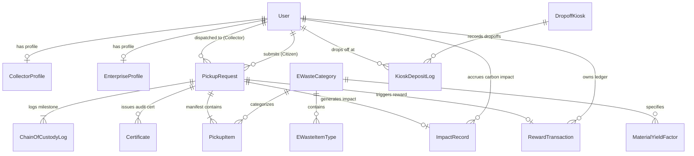

# EcoCircuit — Database Schema & Data Architecture

**Platform:** EcoCircuit — Smart E-Waste Management Platform  
**Database Engine:** PostgreSQL 16+  
**ORM / Data Layer:** Prisma ORM 5.x / 6.x  
**Schema Version:** 1.0.0  

---

## 1. Entity-Relationship (ER) Architecture

The data model is engineered around immutable chain-of-custody tracking, role-segregated user profiles, multi-item pickup manifests, material yield telemetry, and environmental impact accounting.



---

## 2. Core Relational Schema (Prisma Specification)

Below is the production-ready `schema.prisma` file defining tables, enums, relations, indexes, and constraints.

```prisma
datasource db {
  provider = "postgresql"
  url      = env("DATABASE_URL")
}

generator client {
  provider = "prisma-client-js"
}

// =========================================================================
// ENUMS
// =========================================================================

enum UserRole {
  CITIZEN
  COLLECTOR
  ADMIN
  ENTERPRISE
}

enum PickupStatus {
  DRAFT
  SUBMITTED
  ASSIGNED
  EN_ROUTE
  ARRIVED
  VERIFIED
  WEIGHED
  IN_TRANSIT_SMELTER
  RECYCLED_COMPLETED
  CANCELLED
}

enum ItemCondition {
  WORKING
  DAMAGED
  SCRAP_PARTS_ONLY
  HAZARDOUS_LEAKING
}

enum CertificateType {
  DOD_5220_DATA_WIPE
  ISO_14001_DISPOSAL
  SCOPE_3_ESG_OFFSET
}

enum TransactionType {
  CREDIT_REWARD
  DEBIT_REDEMPTION
  ADMIN_ADJUSTMENT
}

enum KioskStatus {
  OPERATIONAL
  NEAR_CAPACITY
  FULL_MAINTENANCE
  OFFLINE
}

// =========================================================================
// USERS & IDENTITY
// =========================================================================

model User {
  id            String    @id @default(uuid()) @db.Uuid
  email         String    @unique @db.VarChar(255)
  passwordHash  String    @db.VarChar(255)
  firstName     String    @db.VarChar(100)
  lastName      String    @db.VarChar(100)
  phoneNumber   String?   @db.VarChar(30)
  avatarUrl     String?   @db.VarChar(512)
  role          UserRole  @default(CITIZEN)
  isEmailVerified Boolean @default(false)
  createdAt     DateTime  @default(now()) @db.Timestamptz
  updatedAt     DateTime  @updatedAt @db.Timestamptz

  // Relational mappings
  collectorProfile    CollectorProfile?
  enterpriseProfile   EnterpriseProfile?
  citizenPickups      PickupRequest[]       @relation("CitizenPickups")
  assignedPickups     PickupRequest[]       @relation("CollectorPickups")
  rewardTransactions  RewardTransaction[]
  impactRecords       ImpactRecord[]
  custodyLogs         ChainOfCustodyLog[]
  certificates        Certificate[]
  kioskDeposits       KioskDepositLog[]

  @@index([email])
  @@index([role])
}

model CollectorProfile {
  id              String      @id @default(uuid()) @db.Uuid
  userId          String      @unique @db.Uuid
  user            User        @relation(fields: [userId], references: [id], onDelete: Cascade)
  companyName     String?     @db.VarChar(150)
  licenseNumber   String      @unique @db.VarChar(100)
  r2v3Certified   Boolean     @default(true)
  vehicleType     String      @db.VarChar(50)  // "Electric Van", "Heavy Cargo", etc.
  vehiclePlate    String      @db.VarChar(30)
  currentLat      Float?
  currentLng      Float?
  lastLocationAt  DateTime?   @db.Timestamptz
  isActiveDuty    Boolean     @default(false)
  totalPickupsCompleted Int   @default(0)
  ratingScore     Float       @default(5.0)

  createdAt       DateTime    @default(now()) @db.Timestamptz
  updatedAt       DateTime    @updatedAt @db.Timestamptz

  @@index([isActiveDuty])
}

model EnterpriseProfile {
  id              String      @id @default(uuid()) @db.Uuid
  userId          String      @unique @db.Uuid
  user            User        @relation(fields: [userId], references: [id], onDelete: Cascade)
  organizationName String     @db.VarChar(200)
  taxIdentifier   String      @db.VarChar(50)
  corporateDomain String      @db.VarChar(100)
  isDoDRequired   Boolean     @default(true)
  contractTier    String      @default("STANDARD") // "STANDARD", "ENTERPRISE_VIP"

  createdAt       DateTime    @default(now()) @db.Timestamptz
  updatedAt       DateTime    @updatedAt @db.Timestamptz
}

// =========================================================================
// E-WASTE CATALOG & MATERIAL YIELDS
// =========================================================================

model EWasteCategory {
  id              String      @id @default(uuid()) @db.Uuid
  slug            String      @unique @db.VarChar(100)
  name            String      @db.VarChar(100)
  description     String      @db.Text
  targetYieldPct  Float       // e.g. 99.2
  tierLevel       String      @default("Tier 1") // "Tier 1", "Tier 2", "Enterprise"
  isEnterprise    Boolean     @default(false)
  iconName        String      @db.VarChar(50)    // "smartphone", "laptop_mac", "bolt", etc.
  basePricePerKg  Decimal     @db.Decimal(10, 2) // Base monetary payout in USD
  co2FactorPerKg  Float       @default(2.45)     // kg CO2 offset per kg recycled

  items           PickupItem[]
  yieldFactors    MaterialYieldFactor[]

  createdAt       DateTime    @default(now()) @db.Timestamptz
  updatedAt       DateTime    @updatedAt @db.Timestamptz

  @@index([slug])
  @@index([isEnterprise])
}

model MaterialYieldFactor {
  id              String         @id @default(uuid()) @db.Uuid
  categoryId      String         @db.Uuid
  category        EWasteCategory @relation(fields: [categoryId], references: [id], onDelete: Cascade)
  elementSymbol   String         @db.VarChar(10) // "Au", "Cu", "Li", "Co", "Ag"
  elementName     String         @db.VarChar(50) // "Gold", "Copper", "Lithium"
  gramsPerKg      Float          // Calibrated yield in grams per kilogram of raw hardware

  createdAt       DateTime       @default(now()) @db.Timestamptz

  @@unique([categoryId, elementSymbol])
}

// =========================================================================
// PICKUP REQUESTS & CUSTODY PIPELINE
// =========================================================================

model PickupRequest {
  id                    String        @id @default(uuid()) @db.Uuid
  trackingNumber        String        @unique @db.VarChar(30) // e.g. "EC-9041-X"
  citizenId             String        @db.Uuid
  citizen               User          @relation("CitizenPickups", fields: [citizenId], references: [id], onDelete: Restrict)
  collectorId           String?       @db.Uuid
  collector             User?         @relation("CollectorPickups", fields: [collectorId], references: [id], onDelete: SetNull)

  status                PickupStatus  @default(SUBMITTED)
  scheduledDate         DateTime      @db.Date
  timeSlot              String        @db.VarChar(50) // "08:00 AM - 12:00 PM"

  // Address & Geolocation
  streetAddress         String        @db.VarChar(255)
  unitApartment         String?       @db.VarChar(50)
  city                  String        @db.VarChar(100)
  stateProvince         String        @db.VarChar(100)
  postalCode            String        @db.VarChar(20)
  latitude              Float
  longitude             Float

  // Cryptographic Verification & Seals
  verificationOtp       String        @db.VarChar(6)   // 6-digit OTP given to citizen
  verificationQrToken   String        @unique @db.VarChar(64) // Signed token for QR scanning
  tamperSealBarcode     String?       @db.VarChar(50)  // Physical security seal barcode tag

  // Weight & Financial Telemetry
  estimatedWeightKg     Float         @default(0.0)
  actualWeightKg        Float?        // Calibrated at collection weigh-in
  estimatedRewardUsd    Decimal       @default(0.00) @db.Decimal(10, 2)
  actualRewardUsd       Decimal?      @db.Decimal(10, 2)

  clientNotes           String?       @db.Text
  collectorNotes        String?       @db.Text

  createdAt             DateTime      @default(now()) @db.Timestamptz
  updatedAt             DateTime      @updatedAt @db.Timestamptz

  // Relational mappings
  items                 PickupItem[]
  custodyLogs           ChainOfCustodyLog[]
  rewardTransaction     RewardTransaction?
  impactRecord          ImpactRecord?
  certificates          Certificate[]

  @@index([status])
  @@index([citizenId])
  @@index([collectorId])
  @@index([trackingNumber])
  @@index([scheduledDate])
}

model PickupItem {
  id                String          @id @default(uuid()) @db.Uuid
  pickupRequestId   String          @db.Uuid
  pickupRequest     PickupRequest   @relation(fields: [pickupRequestId], references: [id], onDelete: Cascade)
  categoryId        String          @db.Uuid
  category          EWasteCategory  @relation(fields: [categoryId], references: [id], onDelete: Restrict)

  itemTitle         String          @db.VarChar(150) // "Apple MacBook Pro 14", "Mixed Power Bricks"
  brand             String?         @db.VarChar(100)
  modelNumber       String?         @db.VarChar(100)
  serialNumber      String?         @db.VarChar(100)
  quantity          Int             @default(1)
  condition         ItemCondition   @default(WORKING)
  estimatedWeightKg Float
  actualWeightKg    Float?
  photoUrl          String?         @db.VarChar(512)
  aiClassification  Json?           // Metadata from neural image model

  createdAt         DateTime        @default(now()) @db.Timestamptz
}

model ChainOfCustodyLog {
  id                String          @id @default(uuid()) @db.Uuid
  pickupRequestId   String          @db.Uuid
  pickupRequest     PickupRequest   @relation(fields: [pickupRequestId], references: [id], onDelete: Cascade)
  actorId           String          @db.Uuid
  actor             User            @relation(fields: [actorId], references: [id], onDelete: Restrict)

  milestoneName     String          @db.VarChar(100) // "Request Confirmed", "Collector Assigned", etc.
  description       String          @db.Text
  latitude          Float?
  longitude         Float?
  tamperSealId      String?         @db.VarChar(50)
  signatureHash     String?         @db.VarChar(64) // SHA-256 digital signature of state
  loggedAt          DateTime        @default(now()) @db.Timestamptz

  @@index([pickupRequestId, loggedAt])
}

// =========================================================================
// REWARDS, WALLET & IMPACT ACCOUNTING
// =========================================================================

model RewardTransaction {
  id                String          @id @default(uuid()) @db.Uuid
  userId            String          @db.Uuid
  user              User            @relation(fields: [userId], references: [id], onDelete: Cascade)
  pickupRequestId   String?         @unique @db.Uuid
  pickupRequest     PickupRequest?  @relation(fields: [pickupRequestId], references: [id], onDelete: SetNull)

  type              TransactionType @default(CREDIT_REWARD)
  amountUsd         Decimal         @db.Decimal(10, 2)
  runningBalanceUsd Decimal         @db.Decimal(10, 2)
  memo              String          @db.VarChar(255)
  processedAt       DateTime        @default(now()) @db.Timestamptz

  @@index([userId])
}

model ImpactRecord {
  id                  String          @id @default(uuid()) @db.Uuid
  userId              String          @db.Uuid
  user                User            @relation(fields: [userId], references: [id], onDelete: Cascade)
  pickupRequestId     String          @unique @db.Uuid
  pickupRequest       PickupRequest   @relation(fields: [pickupRequestId], references: [id], onDelete: Cascade)

  massDivertedKg      Float           // kg diverted from municipal landfill
  co2OffsetMt         Float           // Metric tons of CO2 equivalent offset
  goldRecoveredGrams  Float           @default(0.0) // Au grams
  copperRecoveredKg   Float           @default(0.0) // Cu kilograms
  lithiumRecoveredGrams Float         @default(0.0) // Li grams

  calculatedAt        DateTime        @default(now()) @db.Timestamptz

  @@index([userId])
}

model Certificate {
  id                  String          @id @default(uuid()) @db.Uuid
  certificateNumber   String          @unique @db.VarChar(50) // "CERT-DOD-2026-9041"
  pickupRequestId     String          @db.Uuid
  pickupRequest       PickupRequest   @relation(fields: [pickupRequestId], references: [id], onDelete: Cascade)
  userId              String          @db.Uuid
  user                User            @relation(fields: [userId], references: [id], onDelete: Cascade)

  type                CertificateType
  pdfStorageUrl       String          @db.VarChar(512)
  cryptographicHash   String          @db.VarChar(64) // SHA-256 authenticity proof
  issuedAt            DateTime        @default(now()) @db.Timestamptz

  @@index([certificateNumber])
  @@index([userId])
}

// =========================================================================
// DROPOFF KIOSKS & COMMUNITY TELEMETRY
// =========================================================================

model DropoffKiosk {
  id              String            @id @default(uuid()) @db.Uuid
  name            String            @db.VarChar(150) // "Downtown Hub Kiosk #03"
  streetAddress   String            @db.VarChar(255)
  city            String            @db.VarChar(100)
  latitude        Float
  longitude       Float
  status          KioskStatus       @default(OPERATIONAL)
  fillPercentage  Int               @default(15) // 0 - 100
  operatingHours  String            @default("24/7 Accessible")
  nfcAuthEnabled  Boolean           @default(true)
  qrAuthEnabled   Boolean           @default(true)

  deposits        KioskDepositLog[]

  createdAt       DateTime          @default(now()) @db.Timestamptz
  updatedAt       DateTime          @updatedAt @db.Timestamptz

  @@index([status])
}

model KioskDepositLog {
  id              String        @id @default(uuid()) @db.Uuid
  kioskId         String        @db.Uuid
  kiosk           DropoffKiosk  @relation(fields: [kioskId], references: [id], onDelete: Cascade)
  userId          String?       @db.Uuid
  user            User?         @relation(fields: [userId], references: [id], onDelete: SetNull)

  itemDescription String        @db.VarChar(200)
  estimatedWeightKg Float
  depositedAt     DateTime      @default(now()) @db.Timestamptz
}

model NewsletterSubscriber {
  id              String        @id @default(uuid()) @db.Uuid
  email           String        @unique @db.VarChar(255)
  subscribedAt    DateTime      @default(now()) @db.Timestamptz
  isActive        Boolean       @default(true)
}
```

---

## 3. Database Indexes, Cascades & Optimization

1. **Spatial & Proximity Indexing:**  
   To enable instant querying of the nearest Drop-off Kiosks within a given citizen radius:
   ```sql
   CREATE EXTENSION IF NOT EXISTS cube;
   CREATE EXTENSION IF NOT EXISTS earthdistance;
   CREATE INDEX idx_kiosks_geo ON "DropoffKiosk" USING gist (ll_to_earth(latitude, longitude));
   ```
2. **Immutable Audit Trail Constraints:**  
   The `ChainOfCustodyLog` table prevents `UPDATE` or `DELETE` statements through a PostgreSQL trigger rule:
   ```sql
   CREATE OR REPLACE FUNCTION prevent_audit_tampering()
   RETURNS TRIGGER AS $$
   BEGIN
       RAISE EXCEPTION 'Audit logs in ChainOfCustodyLog are immutable and cannot be updated or deleted.';
   END;
   $$ LANGUAGE plpgsql;

   CREATE TRIGGER trg_no_audit_edit
   BEFORE UPDATE OR DELETE ON "ChainOfCustodyLog"
   FOR EACH ROW EXECUTE FUNCTION prevent_audit_tampering();
   ```
3. **Optimized Aggregation Views:**  
   To supply instant data to the animated landing page tickers without querying millions of row records:
   ```sql
   CREATE MATERIALIZED VIEW mv_platform_telemetry_totals AS
   SELECT
       COALESCE(SUM(mass_diverted_kg), 0) AS total_landfill_diverted_kg,
       COALESCE(SUM(gold_recovered_grams), 0) AS total_gold_recovered_grams,
       COALESCE(SUM(co2_offset_mt), 0) AS total_co2_offset_mt
   FROM "ImpactRecord";

   CREATE UNIQUE INDEX idx_mv_telemetry ON mv_platform_telemetry_totals ((1));
   ```

---

## 4. Database Seeding Strategy

The database will be automatically seeded with:
1. **The 8 E-Waste Categories from `DESIGN.md`:**
   - *Smartphones & Tablets:* 99.2% yield, Tier 1, Au: 0.24 g/kg, Cu: 140 g/kg, Li: 82 g/kg.
   - *Laptops & Computers:* 98.4% yield, Tier 1, Au: 0.12 g/kg, Cu: 220 g/kg.
   - *Lithium Batteries & Packs:* 95.0% yield, Tier 2, Li: 180 g/kg, Co: 95 g/kg.
   - *Chargers & Heavy Cables:* 99.7% yield, Tier 1, Cu: 620 g/kg.
   - *Displays & Televisions:* 91.8% yield, Tier 2, Plastics & Rare Earths.
   - *Smart Home Appliances:* 94.3% yield, Tier 1, Steel & Copper motors.
   - *GPUs & Components:* 99.1% yield, Tier 1, Au: 0.85 g/kg, Ag: 2.1 g/kg.
   - *Data Center & Servers:* 99.8% yield, Enterprise, High Au, Cu, SAN destruction.
2. **Standard Test Personas:**
   - Admin Account: `admin@ecocircuit.org`
   - Verified Collector Account: `marcus.v@ecocircuit.fleet` (EV Van #04)
   - Citizen Account: `demo.citizen@ecocircuit.org`
3. **Drop-Off Kiosks:**
   - `Downtown Hub Kiosk #03` (Lat 37.7833, Lng -122.4167)
   - `Silicon Park Smelter Terminal` (Lat 37.7500, Lng -122.4000)
