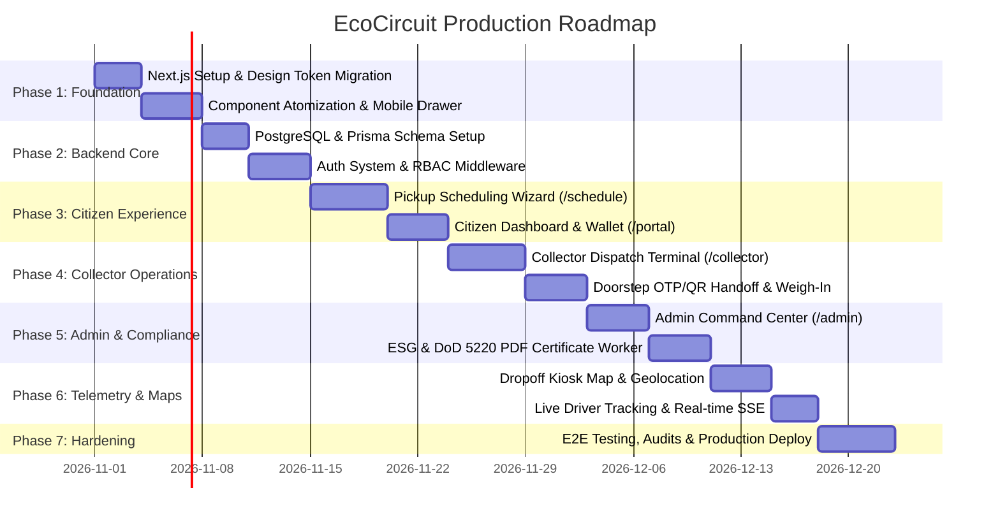

# EcoCircuit — Implementation Roadmap & Execution Strategy

**Platform:** EcoCircuit — Smart E-Waste Management Platform  
**Target Completion:** Production-Ready MVP  
**Framework:** Next.js 15 (App Router) + TypeScript + Tailwind CSS + PostgreSQL + Prisma ORM  

---

## 1. Roadmap Overview & Timeline

The roadmap is structured into 7 distinct sequential phases to ensure seamless transition from the current static prototype (`code.html`) to an enterprise-grade, fully functional web application without compromising the Google Stitch visual identity.

---

## 2. Detailed Phase Breakdown

### Phase 1: Project Setup, Design System Migration & Frontend Modernization
**Goal:** Transform the monolithic `code.html` file into a modern, type-safe Next.js 15 application while preserving 100% of the visual styling, 3D buttons, and animations.

- [ ] **Task 1.1: Project Initialization**
  - Initialize Next.js 15 project with TypeScript, ESLint, PostCSS, and Tailwind CSS.
  - Configure `tsconfig.json` with strict type checking and `@/*` path aliases.
- [ ] **Task 1.2: Design Token & Typography Integration**
  - Migrate all design tokens from `DESIGN.md` into `tailwind.config.ts` (colors, spacing, typography scales, box shadows, borders).
  - Configure `next/font/google` for **Plus Jakarta Sans** and **Inter** with zero layout shift.
  - Setup Lucide-React or Material Symbols Outlined without duplicate network requests.
- [ ] **Task 1.3: Component Atomization & Extraction**
  - Break down `code.html` into clean, modular React components:
    - `src/components/layout/Header.tsx`
    - `src/components/layout/MobileDrawer.tsx` (Resolves the missing mobile navigation issue)
    - `src/components/layout/Footer.tsx`
    - `src/components/ui/TactileButton.tsx` (3D buttons with inset top highlights)
    - `src/components/home/HeroTiltConsole.tsx` (React hook-based 3D tilt with `requestAnimationFrame` debouncing)
    - `src/components/home/CategoryGrid.tsx` & `CategoryCard.tsx`
    - `src/components/home/ImpactLedgerTicker.tsx` (Animated count-up hook)
- [ ] **Task 1.4: Accessibility Hardening**
  - Add `aria-hidden="true"` to decorative icons.
  - Replace non-functional `<a>` anchors with accessible `<button>` triggers.
  - Add semantic `<label>` elements for newsletter and search inputs.

**Definition of Done (DoD):**  
Next.js application renders the home landing page identically to `screen.png`, passes Lighthouse accessibility score > 95, has a working mobile drawer, and compiles with zero TypeScript errors.

---

### Phase 2: Database Setup, ORM Models & Backend Foundation
**Goal:** Establish the PostgreSQL relational schema, run migrations, seed data, and enforce role-based authentication.

- [ ] **Task 2.1: PostgreSQL & Prisma Initialization**
  - Setup PostgreSQL instance and configure connection pool.
  - Apply the complete Prisma schema from `DATABASE_DESIGN.md`.
  - Create database migration `0001_initial_schema`.
- [ ] **Task 2.2: Database Seeding**
  - Write `prisma/seed.ts` to populate:
    - 8 E-Waste categories with yield factors (Au, Cu, Li, Co) and icons.
    - Verified test personas (`admin@ecocircuit.org`, `marcus.v@ecocircuit.fleet`, `demo.citizen@ecocircuit.org`).
    - 4 regional drop-off kiosks in San Francisco Bay Area.
- [ ] **Task 2.3: Authentication & RBAC Middleware**
  - Implement Auth.js / NextAuth v5 credentials provider with Argon2id password hashing.
  - Create `src/middleware.ts` to guard `/portal/*` (`CITIZEN`), `/collector/*` (`COLLECTOR`), and `/admin/*` (`ADMIN`).
  - Implement `/api/v1/auth/register`, `/api/v1/auth/login`, and `/api/v1/auth/me`.

**Definition of Done (DoD):**  
Database is seeded, migrations run cleanly, users can register and log in, and unauthorized access to role-protected routes is securely rejected with 403 Forbidden.

---

### Phase 3: Citizen Portal & Interactive Pickup Scheduling Wizard
**Goal:** Empower citizens to value their e-waste, schedule doorstep pickups, and track their environmental footprint.

- [ ] **Task 3.1: Interactive Pickup Scheduling Wizard (`/schedule`)**
  - Step 1: **Item Manifest Builder** — Select from 8 categories, enter brand/model, specify condition, upload photo.
  - Step 2: **Instant AI/Algorithmic Valuation** — Calculates estimated weight, scrap payout in USD, and carbon offset MT in real-time.
  - Step 3: **Address & Time Slot Picker** — Street address autocomplete, apartment/gate notes, date picker, and 4-hour morning/afternoon time window.
  - Step 4: **Confirmation & Security Code** — Generates 6-digit OTP and dynamic QR code for doorstep handoff.
- [ ] **Task 3.2: Citizen Dashboard (`/portal`)**
  - Personal environmental ledger: Cumulative carbon saved (kg), trees equivalent, total mass diverted.
  - Eco-Rewards wallet balance with transaction ledger and cash-out/voucher redemption.
  - Active pickup tracking card displaying live milestone progress.
  - Historic pickup receipts with downloadable certificates.

**Definition of Done (DoD):**  
A citizen can select items, receive a real-time valuation quote, submit a pickup request, view their booking in the portal, and receive a 6-digit verification code.

---

### Phase 4: Collector/Scrapper Operations Dashboard & Chain-of-Custody
**Goal:** Provide field logistics agents with dispatch tools to accept pickups, navigate to locations, verify handoffs, and record scrap weights.

- [ ] **Task 4.1: Collector Terminal (`/collector`)**
  - On-duty / Off-duty status toggle switch.
  - Real-time dispatch feed showing open pickup requests sorted by proximity.
  - "Accept Pickup" and "Start Route" action triggers.
- [ ] **Task 4.2: Doorstep Verification & Weigh-In Module**
  - Customer Verification: Collector enters Citizen 6-digit OTP or scans QR code.
  - Tamper Seal Tagging: Assigns physical barcode seal tag (e.g. `SEAL-992-B`).
  - Digital Scale Weigh-In: Records actual calibrated weight and takes verification photo.
  - Backend recalculates final eco-reward payout and triggers immutable `ChainOfCustodyLog` entry.
- [ ] **Task 4.3: Smelter Hub Delivery**
  - Collector marks delivery to certified smelter facility (R2v3 / e-Stewards).
  - Status updates to `RECYCLED_COMPLETED`.

**Definition of Done (DoD):**  
A collector can log into `/collector`, accept an open job, arrive at the doorstep, authenticate the pickup via OTP, enter calibrated weights, and mark the batch delivered.

---

### Phase 5: Admin Operations, Telemetry Control & ESG Certificate Generator
**Goal:** Deliver platform operators total control over system telemetry, collector verification, and automated compliance auditing.

- [ ] **Task 5.1: Master Command Center (`/admin`)**
  - Platform overview: Active collectors, pickups in transit, daily landfill mass diverted.
  - User & Collector Management: Review pending collector applications, verify R2/e-Steward certifications, and toggle verification badges.
  - Dispute resolution: Manual override for weight discrepancies or cancelled runs.
- [ ] **Task 5.2: ESG Certificate & Data Destruction Engine**
  - Implement PDF generation worker using `@react-pdf/renderer` or `pdfkit`.
  - Generates tamper-proof PDF vouchers:
    - **DoD 5220.22-M Sanitization Certificate:** Serial-number-specific wipe proof for laptops and enterprise servers.
    - **Scope 3 ESG Carbon Credit Voucher:** Auditable greenhouse gas avoidance certificate.
  - Each certificate embeds a verifiable SHA-256 cryptographic proof hash and QR verification link.

**Definition of Done (DoD):**  
Admins can monitor all platform activities, approve collectors, and citizens/enterprises can download cryptographically signed compliance PDF certificates.

---

### Phase 6: Kiosk Locator, Interactive Maps & Real-Time Telemetry
**Goal:** Integrate spatial mapping for regional kiosks and live telemetry feeds for active in-transit pickups.

- [ ] **Task 6.1: Drop-off Kiosk Map Interface**
  - Integrate interactive Leaflet or Mapbox map displaying geocoded drop-off terminals.
  - Displays live fill percentages (0-100%), operating hours, and NFC/QR credentials.
  - Filter kiosks by accepted materials.
- [ ] **Task 6.2: Real-time Telemetry & Live Tickers**
  - Implement Server-Sent Events (SSE) route `/api/v1/telemetry/stream/:trackingNumber`.
  - Connect the landing page animated counters directly to `GET /api/v1/telemetry/live-stats` so that real database numbers tick into view.
  - Enable the footer "Establish Link" newsletter form to persist subscriber emails.

**Definition of Done (DoD):**  
Interactive kiosk map allows citizens to find nearby drop-off points, active pickups show live simulated driver movement, and landing page tickers reflect live database aggregates.

---

### Phase 7: Testing, Performance Optimization, Security Hardening & Deployment
**Goal:** Ensure enterprise-grade reliability, data privacy, high availability, and rapid load times.

- [ ] **Task 7.1: Automated Testing Suite**
  - Unit tests for valuation math, yield calculations, and carbon formulas (Vitest).
  - Integration tests for auth, pickup lifecycle, and handoff verification.
  - End-to-end (E2E) workflow tests via Playwright (Citizen creates booking $\rightarrow$ Collector verifies via OTP $\rightarrow$ Admin verifies certificate).
- [ ] **Task 7.2: Security Hardening**
  - Rate limiting on public and auth endpoints (`upstash/ratelimit`).
  - Strict Content Security Policy (CSP), CORS headers, and Helmet integration.
  - Input sanitization against XSS, SQL injection, and CSV injection.
- [ ] **Task 7.3: Production Deployment & Dockerization**
  - Multi-stage `Dockerfile` with non-root Alpine container.
  - `docker-compose.yml` orchestrating Next.js, PostgreSQL 16, and Redis.
  - Automated database backup and health check routines.

**Definition of Done (DoD):**  
All tests pass with > 85% code coverage, zero critical security vulnerabilities on audit, and system is fully deployable via Docker with one command (`docker compose up -d`).

---

## 3. Risk Assessment & Mitigation Matrix

| Identified Risk | Severity | Likelihood | Mitigation Strategy |
| :--- | :--- | :--- | :--- |
| **Tampered or Ghost Pickups** | Critical | Medium | Dual-sided handoff: Citizen OTP + Collector GPS verification within 50m geofence required before job can transition. |
| **Weight Discrepancy Disputes** | High | High | Citizen estimate is clearly marked as provisional; collector weigh-in requires timestamped photo proof if variance exceeds 15%. |
| **Tailwind CDN Performance Bottleneck** | Medium | High | Replaced in Phase 1 with compiled PostCSS Tailwind build, reducing initial bundle payload from 3.5MB to < 50KB. |
| **Private Data Leakage on Manifests** | Critical | Low | Strict database queries filtering by `userId`; collectors only receive address and contact details after accepting dispatch. |
| **Broken Third-Party Image URLs** | Medium | Medium | Migrate external Google User Content avatars to local self-hosted assets or validated object storage uploads. |
