# EcoCircuit — Project Analysis & Technical Audit

**Project:** EcoCircuit — Smart E-Waste Management Platform  
**Audit Date:** October 2026  
**Auditor:** Senior Full-Stack Software Engineer, System Architect & UI/UX Designer  
**Scope:** Frontend Codebase (`code.html`), Visual Design System (`DESIGN.md`), Asset Review, Architecture Gap Analysis  

---

## 1. Executive Summary

EcoCircuit is conceptualized as an enterprise-grade and citizen-centric e-waste reclamation and circular economy telemetry platform. The current repository contains a high-fidelity visual prototype generated via Google Stitch (`code.html`), an architectural design token specification (`DESIGN.md`), and a visual reference render (`screen.png`).

The visual interface achieves an impressive aesthetic: a luminous modern fintech meets environmental intelligence motif featuring sage and emerald palettes, tactile 3D buttons, levitating telemetry cards, and physics-inspired mouse-tilt interactions.

However, from an engineering and functional perspective:
- The project currently exists exclusively as a **static single-page HTML mockup** using client-side CDN-compiled Tailwind CSS.
- **No backend, API, or database exists.**
- **All navigation links, portal buttons, and modal triggers lead to dead anchor links (`href="#"`).**
- **All metrics, counters, driver routes, and user statistics are static mock data.**
- The three core user personas (**Citizens**, **Collectors/Scrappers**, and **Administrators**) have no working workflows, authentication gates, or operational dashboards.

This document provides a thorough audit of what currently works, what does not work, components suitable for reuse, critical UI/UX and accessibility gaps, and the blueprint for converting this prototype into a production web application.

---

## 2. Project Folder Structure & Asset Audit

### Current Workspace Structure
```
stitch_ecocircuit_premium_ui_redesign/
├── DESIGN.md           # Visual design tokens, color palette, typography, elevation tiers
├── code.html           # 913-line monolithic HTML prototype with Tailwind CDN & inline JS
├── screen.png          # High-resolution visual capture of the rendered Stitch design
└── .Rhistory           # Empty runtime shell history artifact (0 bytes)
```

### Observations on Existing Assets
1. **Monolithic Layout:** All markup, inline Tailwind configuration, embedded SVG assets, and vanilla JavaScript logic reside inside a single 913-line file (`code.html`).
2. **Missing Package Ecosystem:** There is no `package.json`, no dependency lockfile, no build scripts, and no bundler configuration (Vite, Next.js, or Webpack).
3. **External Hotlinked Assets:** User avatars and brand icons rely on ephemeral Google CDN URLs (`https://lh3.googleusercontent.com/...`). These assets must be replaced with local, optimized SVG/WebP assets to avoid 404 broken links in production.
4. **Duplicate Font Loading:** Lines 3 and 4 of `code.html` duplicate Google Fonts imports for `Material Symbols Outlined`.

---

## 3. Frontend Framework & Technology Stack

| Layer | Existing Implementation | Production Target Architecture |
| :--- | :--- | :--- |
| **Framework** | None (Vanilla HTML5) | React 19 / Next.js 15 (App Router with Server Components) |
| **CSS / Styling** | Tailwind CDN (`cdn.tailwindcss.com` with runtime JIT compilation) | Tailwind CSS v3.4 / v4 installed via PostCSS/npm build pipeline |
| **Iconography** | Google Material Symbols Outlined (CDN) | Lucide-React or `@material-symbols/svg` |
| **Typography** | Google Fonts: Plus Jakarta Sans (Headings) & Inter (Body/Data) | `next/font/google` with local self-hosting and zero layout shift |
| **Client Scripting** | Inline Vanilla JavaScript (3D tilt, IntersectionObserver counter, tab filter) | Modular React hooks (`useMotionTilt`, `useCountUp`, state-driven filters) |
| **State Management** | None | Zustand / React Query (TanStack Query v5) for server state |
| **Routing** | None (Single-page `#` anchors) | Next.js App Router (`/`, `/schedule`, `/citizen`, `/collector`, `/admin`) |

---

## 4. Comprehensive Page, Component & Workflow Audit

### 4.1 Header & Navigation
- **Elements:** Brand Logo ("EcoCircuit"), desktop navigation links (`Solutions`, `How It Works`, `E-Waste Categories`, `Citizen Portal`, `Enterprise & Impact`, `Pricing`), Live Pickup Status indicator pill, "Schedule Pickup" CTA button, User Avatar badge with status dot.
- **Status:** **Partially functional visually, non-functional dynamically.**
- **Issues:**
  - Responsive collapse flaw: `nav` uses `hidden xl:flex`. On viewports below 1280px (tablets and mobile phones), the navigation links completely disappear without a hamburger menu or mobile drawer.
  - All navigation links use `href="#"` with dummy `data-path` attributes.
  - The Live Pickup Status pill is hardcoded as an animated pulse with no connection to real pickup telemetry.
  - The profile avatar cannot be clicked; there is no user dropdown, account settings modal, or authentication trigger.

### 4.2 Hero Section & Levitating 3D Recycling Console
- **Elements:** Glass pill indicator ("Smart E-Waste Management Platform"), primary headline with gradient clip ("Your E-Waste. A Greener Tomorrow."), lead copy, primary CTA ("Schedule a Pickup"), secondary CTA ("Explore EcoCircuit"), social proof badge (48,500+ kg mass diverted).
- **Interactive 3D Tilt Console:** Right-column levitating card featuring:
  - Top Bar Telemetry (`Console // Node EC-9041`, `Live In-Transit`).
  - Radar Telemetry Map Mock with rotating radar pulse SVG and animated courier ping (`Courier #24`, `ETA: 14 mins`, `9.4 km to Hub`).
  - Pure Recovery circular SVG gauge (78.4%, Au: 24g, Cu: 1.4kg, Li: 820g).
  - Floating parallax chips: iPhone 14 Pro, Lithium-Polymer Cell battery level, Enterprise Batch toast notification.
- **Status:** **Visually active & interactive via mouse movements; data is 100% static mock content.**
- **Issues:**
  - Mousemove event listener on `#hero-3d-scene` runs on raw mouse movements without `requestAnimationFrame` debouncing or passive event listeners.
  - "Schedule a Pickup" CTA points to `href="#"`.
  - Telemetry console details are hardcoded SVG and HTML text.

### 4.3 Trust Seals & Compliance Bar
- **Elements:** 4 enterprise certifications: R2v3 Certified, e-Stewards Standard, DoD 5220.22-M Sanitized, Zero-Landfill Pledge.
- **Status:** **Static presentation.** Functional as a credibility anchor, but lacks verification tooltips or links to compliance documentation.

### 4.4 Telemetry Interfaces Preview (3 Modular Cards)
- **Card 1: Citizen Circular Portal**
  - Displays: Carbon Saved (342 kg), Eco-Rewards ($128.50), Monthly Recycled Mass visual bar graph (18.4 kg), "4 Pickups Completed", and "Launch Portal" link.
  - Reality: Static mock figures; "Launch Portal" points to `href="#"`.
- **Card 2: Pickup Tracking Pipeline**
  - Displays: 4-step vertical chain of custody: Request Confirmed (08:30 AM), Collector Assigned (Agent Marcus V., EV Van #04), Waste In-Transit to Smelter (GPS Seal #992-B Locked), Recycling & Smelting Certificate (Estimated 04:30 PM), "Live Map View" link.
  - Reality: Static HTML markup; "Live Map View" points to `href="#"`.
- **Card 3: Drop-off Kiosks**
  - Displays: "12 Nearby", Geofence Bay Area Sector 7, Downtown Hub Kiosk #03 (0.8 mi), Silicon Park Smelter Terminal (3.2 mi), "Find Drop-off" link.
  - Reality: Static mock locations; no Leaflet/Mapbox/Google Maps integration; "Find Drop-off" points to `href="#"`.

### 4.5 E-Waste Categories (8 Cards Grid)
- **Elements:** Filter tabs (`All Items`, `Consumer`, `Enterprise`) and 8 category cards:
  1. Smartphones & Tablets (Consumer, 99.2% Yield, Gold & Cobalt, Tier 1)
  2. Laptops & Computers (Consumer, 98.4% Yield, DoD 5220 Wiped, Tier 1)
  3. Lithium Batteries & Packs (Consumer, 95.0% Yield, Hazmat Certified, Tier 2)
  4. Chargers & Heavy Cables (Consumer, 99.7% Yield, High-Purity Cu, Tier 1)
  5. Displays & Televisions (Consumer, 91.8% Yield, Mercury-Free Safe, Tier 2)
  6. Smart Home Appliances (Consumer, 94.3% Yield, Motor Extraction, Tier 1)
  7. GPUs & Components (Enterprise, 99.1% Yield, Precious Metals, Tier 1)
  8. Data Center & Servers (Enterprise, 99.8% Yield, Cert. Serial Destruction, Enterprise)
- **Status:** **Filter tabs work dynamically via vanilla JS!** Clicking `Consumer` or `Enterprise` filters the cards using `data-type`.
- **Issues:**
  - Arrow buttons on cards are visual indicators only; clicking does not open an item detail modal or pre-fill a pickup booking request.
  - Yield percentages and material yields are hardcoded strings rather than database-driven category records.

### 4.6 How It Works & Real-Time Impact Ledger
- **Elements:**
  - 4-step pipeline: (01) Instant Digital Inventory, (02) Doorstep GPS Pickup, (03) Certified Dismantling, (04) ESG & Carbon Audit.
  - Animated Impact Counters: 179,053 kg Landfill Diverted, 937 g Pure Gold Extracted, 797 MT CO2 Offset.
- **Status:** **Animation works via IntersectionObserver!** The counter animates smoothly when scrolled into view.
- **Issues:** Counter values are hardcoded in `data-target` attributes rather than reflecting live aggregated database sums.

### 4.7 Enterprise Case Study & ITAD Governance
- **Elements:** Testimonial quote from Dr. Aris Thorne (Chief Sustainability & Security Officer, HyperScale Data Labs), avatar image, "Zero Data Leakage Guarantee" badge.
- **Status:** Static presentation.

### 4.8 Final Conversion Banner
- **Elements:** Callout ("Ready to turn discarded silicon into clean circular future?"), "Book Instant Pickup" button, "Enterprise Consultation" button.
- **Status:** Both buttons have `href="#"` and trigger no action.

### 4.9 Footer & Telemetry Newsletter
- **Elements:** Brand summary, certification badges, navigation links (`Recovery Operations`, `Access Portals`), newsletter form (`terminal.auth@corp.net` input + `Establish Link` button), copyright and legal links.
- **Status:**
  - The newsletter input has no `<label>` (fails accessibility).
  - The button is `<button type="button">` with no event listener or API submission.
  - All footer links are dead `href="#"`.

---

## 5. What Currently Works vs. What Does Not Work

### What Currently Works
1. **Visual Fidelity & Styling:** Pixel-accurate implementation of the `DESIGN.md` tokens (warm off-white surfaces `#FAFAF5`, emerald `#16A34A`, border `#E2EBE4`, typography sizing).
2. **Interactive 3D Console Tilt:** Mouse movements over the hero section calculate 3D perspective rotation on the card and parallax depth displacement on floating badges.
3. **Category Tab Filtering:** JavaScript tab filtering successfully switches between "All Items", "Consumer", and "Enterprise" cards.
4. **Impact Counter Animation:** IntersectionObserver initiates ease-out numerical ticking when the impact banner enters the viewport.
5. **Smooth Scrolling:** Clicking `#how-it-works` scrolls smoothly to the custody pipeline section.

### What Does Not Work
1. **Every CTA and Navigation Trigger:**
   - Header "Schedule Pickup" $\rightarrow$ Inactive (`href="#"`).
   - Hero "Schedule a Pickup" $\rightarrow$ Inactive (`href="#"`).
   - Floating Card "Launch Portal" $\rightarrow$ Inactive (`href="#"`).
   - Floating Card "Live Map View" $\rightarrow$ Inactive (`href="#"`).
   - Floating Card "Find Drop-off" $\rightarrow$ Inactive (`href="#"`).
   - Conversion Banner "Book Instant Pickup" $\rightarrow$ Inactive (`href="#"`).
   - Conversion Banner "Enterprise Consultation" $\rightarrow$ Inactive (`href="#"`).
   - Footer "Establish Link" newsletter submit $\rightarrow$ Inactive.
2. **Responsive Mobile Navigation:** No hamburger menu or mobile drawer exists; header navigation disappears on screens under 1280px.
3. **No Dynamic Data:** Every telemetry badge, recovery percentage, driver ETA, and ledger figure is hardcoded in the HTML string.
4. **No Authentication or Role-Based Views:** No login, registration, or session handling for Citizens, Collectors, or Admins.
5. **No Form Validation or Submission Logic:** The platform cannot accept a single pickup request, address, device list, or email address.

---

## 6. Backend Integration & Database Storage Requirements

### Features Requiring Backend Integration
1. **Authentication & Role Authorization:** Citizen, Collector/Scrapper, and Administrator sign-up, email verification, OAuth (Google/GitHub), JWT session management, and RBAC middleware.
2. **Pickup Scheduling Engine:** Multi-step pickup request pipeline with address geocoding, time-slot allocation, item categorization, photo uploads, and status transitions.
3. **Real-time Telemetry & Collector Dispatch:** Dispatching pickup requests to nearby certified collectors, live GPS location updates via WebSockets or Server-Sent Events, and driver route mapping.
4. **Chain-of-Custody Verification System:** Cryptographic OTP/QR code handoff verification between citizen and collector at doorstep pickup, tamper-evident digital seal logging, and scrap weigh-in verification.
5. **Dynamic Impact & Valuation Calculator:** Real-time valuation algorithms calculating scrap recovery worth, carbon offset credits, and material yields (Au, Cu, Li, Co) based on live market pricing and item categories.
6. **Certificate Generation Engine:** Automated PDF generation for DoD 5220.22-M data destruction compliance certificates, ISO 14001 disposal vouchers, and Scope 3 ESG audit vouchers.
7. **Drop-off Kiosk Geolocation Engine:** Spatial queries (PostGIS / Haversine formula) to calculate nearest kiosks, live operating capacity, and operating hours.

### Data Requiring Database Storage
1. **User Accounts & Roles:** Citizens, Enterprise Clients, Collectors/Scrappers, System Admins.
2. **Collector Credentials & Fleet Data:** Collector business licenses, R2v3 certifications, vehicle telemetry, active duty status, and current GPS coordinates.
3. **E-Waste Material Catalog:** Device types, categories (Consumer vs. Enterprise), average component mass, precious metal yields, toxic material flags, and unit scrap values.
4. **Pickup Requests & Items:** Request status (`PENDING`, `ACCEPTED`, `ASSIGNED`, `IN_TRANSIT`, `VERIFIED`, `RECYCLED`), scheduled timestamps, pickup address, GPS coordinates, uploaded hardware photos, serial numbers, estimated vs. actual weights.
5. **Chain-of-Custody Audit Logs:** Immutable timestamped milestone logs, GPS coordinates at handoff, verification actor IDs, digital signatures, and tamper-seal barcodes.
6. **Drop-off Kiosks & Facilities:** Terminal names, latitude/longitude, street addresses, current fill level percentage, accepted waste types, and operating hours.
7. **Rewards & Wallet Ledger:** Citizen reward balances, transaction history, carbon credits accrued, and redemption status.
8. **Aggregated Impact Telemetry:** Platform-wide totals for mass diverted (kg), gold extracted (g), and MT CO2 offset for the live animated ticker.

---

## 7. Missing Features & Workflows

```mermaid
flowchart TD
    subgraph Missing Citizen Workflow
        C1[Register / Login] --> C2[Select E-Waste Items]
        C2 --> C3[Photo Upload & Serial Entry]
        C3 --> C4[Address & Time-Slot Picker]
        C4 --> C5[Get Reward Valuation Quote]
        C5 --> C6[Confirm Pickup & Receive OTP]
        C6 --> C7[Live Driver Tracking & Doorstep Handoff]
        C7 --> C8[Receive Eco-Reward & ESG Certificate]
    end

    subgraph Missing Collector Workflow
        COL1[Collector Onboarding & Verification] --> COL2[Duty Status Toggle Active/Inactive]
        COL2 --> COL3[Incoming Dispatch Feed]
        COL3 --> COL4[Accept / Reject Job]
        COL4 --> COL5[Turn-by-Turn GPS Navigation]
        COL5 --> COL6[Doorstep OTP/QR Verification]
        COL6 --> COL7[Weigh-In & Barcode Seal Tagging]
        COL7 --> COL8[Deliver to Certified Smelter Hub]
    end

    subgraph Missing Administrator Workflow
        A1[Admin Dashboard Telemetry] --> A2[Manage Users & Collectors]
        A2 --> A3[Approve / Revoke Scrapper Licenses]
        A3 --> A4[Monitor Real-time Chain of Custody]
        A4 --> A5[Manage Kiosks & Processing Hubs]
        A5 --> A6[Export Scope 3 ESG Audit Reports]
    end
```



---

## 8. Component Reusability Matrix

The visual code in `code.html` contains exceptional UI components that can be extracted directly into modular, clean React / Tailwind components:

| Stitch Component in `code.html` | Extracted Production Component | Proposed File Path |
| :--- | :--- | :--- |
| Floating Navigation Bar (lines 4) | `<Header />` & `<MobileDrawer />` | `src/components/layout/Header.tsx` |
| Primary Tactile Button (lines 40-43) | `<TactileButton variant="primary" />` | `src/components/ui/TactileButton.tsx` |
| Secondary Glass Button (lines 45-48) | `<TactileButton variant="secondary" />` | `src/components/ui/TactileButton.tsx` |
| 3D Perspective Tilt Console (lines 72-155) | `<HeroTiltConsole />` | `src/components/home/HeroTiltConsole.tsx` |
| Floating Parallax Badges (lines 156-191) | `<ParallaxBadge />` | `src/components/home/ParallaxBadge.tsx` |
| Trust Seals Bar (lines 197-221) | `<TrustSealsBar />` | `src/components/home/TrustSealsBar.tsx` |
| Citizen Portal Preview Card (lines 245-293) | `<CitizenPreviewCard />` | `src/components/home/CitizenPreviewCard.tsx` |
| Pickup Milestone Timeline (lines 295-368) | `<MilestonePipeline />` | `src/components/tracking/MilestonePipeline.tsx` |
| Drop-off Kiosk Card (lines 370-417) | `<KioskPreviewCard />` | `src/components/home/KioskPreviewCard.tsx` |
| Category Card Grid & Filter (lines 423-618) | `<CategoryGrid />` & `<CategoryCard />` | `src/components/catalog/CategoryGrid.tsx` |
| 4-Step Custody Journey (lines 633-699) | `<HowItWorksSteps />` | `src/components/home/HowItWorksSteps.tsx` |
| Animated Impact Counter Banner (lines 701-734) | `<ImpactLedgerTicker />` | `src/components/home/ImpactLedgerTicker.tsx` |
| Enterprise Testimonial (lines 740-771) | `<EnterpriseTestimonial />` | `src/components/home/EnterpriseTestimonial.tsx` |
| Conversion CTA Banner (lines 776-802) | `<ConversionBanner />` | `src/components/home/ConversionBanner.tsx` |
| Footer & Subscription Form (lines 913) | `<Footer />` | `src/components/layout/Footer.tsx` |

---

## 9. Usability, Accessibility, Performance & Security Audit

### 9.1 Usability & UI/UX Issues
- **Missing Feedback Loops:** Interactive buttons currently give no visual indication that they are awaiting implementation (no toast alerts, no disabled states).
- **No Mobile Navigation:** On viewports under 1280px wide, the desktop navigation links are hidden, leaving users without a menu on mobile devices.
- **Scroll Hijacking in CSS:** The base style includes `::-webkit-scrollbar{display:none;}` and `body{overscroll-behavior:none;}`, which can cause usability issues across different operating systems and browser window managers.
- **Form State Feedback:** The newsletter email field has no validation error state, no loading spinner, and no success confirmation alert.

### 9.2 Accessibility (WCAG 2.1 AA) Violations
1. **Screen Reader Icon Bloat:** Material Symbols are rendered as raw text inside `<span>` tags without `aria-hidden="true"`. Screen readers read aloud literal strings like "donut_large", "bolt", and "edgesensor_high".
2. **Missing Form Labels:** The email input in the footer lacks a semantic `<label>` or `aria-label`, failing WCAG 3.3.2 (Labels or Instructions).
3. **Inappropriate Semantic Tags:** Links configured as `<a href="#">` that trigger client-side state should be semantic `<button type="button">` elements to support keyboard focus and spacebar triggers.
4. **Color Contrast Deficiencies:** Text styled in `text-[10px]` with color `#4B6354` on `#F5F7F0` surfaces does not meet the 4.5:1 minimum contrast ratio for legibility.
5. **No `aria-live` on Dynamic Counters:** The impact counter ticks up numbers in the DOM without `aria-live="polite"`, meaning assistive tech users receive no indication of metric updates.

### 9.3 Performance Deficiencies
1. **Tailwind Runtime CDN:** Using `cdn.tailwindcss.com` compiles styles in the browser at runtime using client-side JavaScript (~3.5MB unminified bundle overhead), causing noticeable First Contentful Paint (FCP) delays.
2. **Unoptimized Remote Images:** Avatar images are loaded directly from remote Google servers with long parameter strings without responsive `srcset` or modern WebP/AVIF formats.
3. **Duplicate Font Requests:** The HTML head requests Google Material Symbols Outlined in two consecutive `<link>` tags.
4. **Unthrottled Mousemove Listener:** The 3D card tilt listener runs synchronously on every mouse coordinate dispatch rather than utilizing `requestAnimationFrame` or CSS custom properties.

### 9.4 Security Vulnerabilities to Guard Against
1. **Unprotected API Endpoints:** Once APIs are introduced, pickup creation, user updates, and scrap logging must be shielded by strict JWT/session validation and CSRF defenses.
2. **Role Elevation & IDOR Risks:** Platform must prevent citizens from viewing or modifying other citizens' pickup requests or accessing collector dispatch queues.
3. **Tamperable Verification:** Physical pickup handoffs must enforce dual-sided cryptographic verification (collector scans citizen QR or enters single-use citizen OTP) to prevent phantom pickup claims.
4. **Unsanitized File Uploads:** Citizens and enterprise clients uploading hardware photos or enterprise serial CSVs must be sanitized against malicious payloads, oversized files, and MIME spoofing.

---

## 10. Recommendations & Implementation Strategy

1. **Retain Visual Identity:** Fully preserve the Stitch visual tokens (`#FAFAF5` canvas, `#16A34A` emerald highlights, Plus Jakarta Sans typography, tactile 3D buttons, and floating glass cards).
2. **Migrate to Next.js 15 App Router:** Convert the monolithic `code.html` into a structured, type-safe Next.js + TypeScript application with production Tailwind CSS.
3. **Construct Modular Navigation & Mobile Drawer:** Build a mobile-friendly hamburger menu drawer with smooth slide-over animation for screens < 1280px.
4. **Implement 3 Full-Featured Portal Modules:**
   - **Citizen Portal (`/portal`):** Schedule pickups, track active bookings, view personal carbon offset ledger, and locate kiosks.
   - **Collector Dashboard (`/collector`):** Live dispatch queue, map navigation, OTP verification, and scrap weigh-in.
   - **Admin Command Center (`/admin`):** Telemetry controls, collector verification, dispute resolution, and ESG PDF export.
5. **Implement Robust Backend & PostgreSQL Database:** Follow the detailed architectural blueprints in `BACKEND_ARCHITECTURE.md`, `DATABASE_DESIGN.md`, and `API_PLAN.md`.
